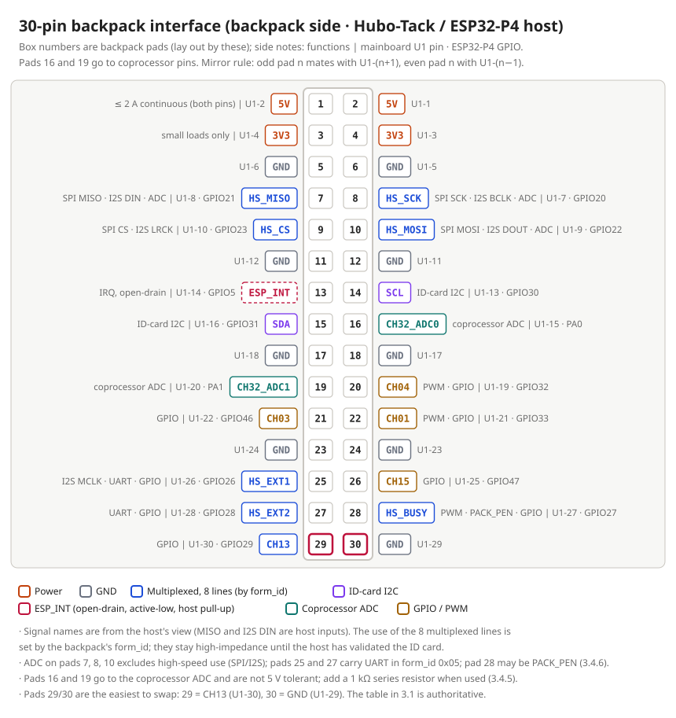

English | [简体中文](./README.zh-CN.md)

# hubo-backpack-spec

Interface specification for **Hubo-Tack 30-Pin backpacks**: pinout, mechanics, power and the ID card. A backpack is an add-on board that plugs into the 30-pin connector on the back of the host; three kinds of host use the same connector: Hubo-Tack (ESP32-P4, the reference host of this specification), the S3 host (ESP32-S3), and the CM series (in development).

## 30-pin interface at a glance

Numbers are **backpack pad numbers** (lay out by these), mirrored against the mainboard `U1` pins: odd pad n mates with `U1`-(n+1), even pad n with `U1`-(n−1). Functions are for the Hubo-Tack (ESP32-P4) host. The S3 host and the CM series (in development) use the same connector with identical power and ground pins; for functional differences see [SPEC-003 1.4](./docs/en/30pin-backpack-spec.md).

| Pins (backpack pads) | Use | Key points |
|---|---|---|
| 1, 2 | `5V` | Main backpack supply, ≤ 2 A continuous (3 A only briefly). There is **no fuse or current limit** between the mainboard and the 30-pin connector, so a backpack short pulls down the mainboard supply (the template includes an eFuse) |
| 3, 4 | `3V3` | Small loads only, such as the ID card and pull-up/pull-down resistors (limit in SPEC-003 3.3.2); RF, LEDs, amplifiers and the like use `5V` and regulate locally |
| 7–10, 25, 27–29 | 8 multiplexed lines | SPI, I2S, UART, PWM or GPIO; pads 7, 8 and 10 can also be ADC. **Their use is set by `form_id` in the ID card**; they stay high-impedance until the host has identified the backpack |
| 14, 15 | ID-card I2C (`SCL`, `SDA`) | ID-card addresses 0x50–0x57, DIY uses 0x57; other I2C devices must avoid these 8 addresses; pull-ups are on the mainboard, none on the backpack |
| 13 | `ESP_INT` | Interrupt, open-drain, active-low, pull-up on the mainboard |
| 16, 19 | Coprocessor ADC | Not 5 V tolerant; add a 1 kΩ series resistor when used |
| 20, 21, 22, 26 | GPIO / PWM | Left floating by default |
| 5, 6, 11, 12, 17, 18, 23, 24, 30 | `GND` | — |

> **Placement:** external connectors (USB-C, HDMI, RJ45, SMA, buttons and the like) must be on the right board edge, opposite the header; none on the header side. See SPEC-003 2.11–2.14.

> **Note:** pad 29 = `CH13` and pad 30 = `GND`; the last two pins are the easiest to swap. The [SPEC-003 3.1 pin table](./docs/en/30pin-backpack-spec.md) is authoritative.

## Specifications

The Chinese version is authoritative; the English version is a translation that follows it clause by clause.

| Specification | English | 简体中文 |
|---|---|---|
| 30-Pin backpack spec (SPEC-003 public edition V1.6): mechanics, pinout, power, signals, schematic and layout rules, pre-fabrication checklist | [docs/en/30pin-backpack-spec.md](./docs/en/30pin-backpack-spec.md) | [docs/zh-CN/30pin-backpack-spec.md](./docs/zh-CN/30pin-backpack-spec.md) |
| Backpack ID card spec (SPEC-004 public edition V2.2): I2C address plan, 12-byte descriptor, `form_id`, `product_id` rules, programming | [docs/en/id-card-spec.md](./docs/en/id-card-spec.md) | [docs/zh-CN/id-card-spec.md](./docs/zh-CN/id-card-spec.md) |
| PCB layout general spec (SPEC-005 public edition V0.12, draft): signal grades, USB/SPI/MIPI/SDIO/clock/RF routing, basic routing rules for all nets, ESP32-P4/S3/C3 appendices | [docs/en/pcb-layout-spec.md](./docs/en/pcb-layout-spec.md) | [docs/zh-CN/pcb-layout-spec.md](./docs/zh-CN/pcb-layout-spec.md) |

Section and clause numbers (for example `SPEC-003 3.4.1`, `SPEC-004 2.2`) are stable and are quoted by the check scripts in hubo-backpack-skill.

## DIY backpacks and product_id

- **A DIY backpack must use the 0x57 programmed ID card** (`AT24C02`, `A0`–`A2` all tied to `3V3`, 12-byte descriptor written). Addresses 0x50–0x56 are reserved for official models.
- **DIY range: `0xF000`–`0xFFFE`.** For personal use, not guaranteed globally unique, no application needed. `0x0000` and `0xFFFF` are forbidden.
- **Need a globally unique `product_id`?** [Open an issue with the product-id request template](https://github.com/hubosmart/hubo-backpack-spec/issues/new?template=product-id-request.md).
- Generate the ID card image with `idcard_image.py` from hubo-backpack-skill; programming steps are in Chapter 5 of the ID card spec.

## Related repositories

- [hubo-backpack-skill](https://github.com/hubosmart/hubo-backpack-skill): AI agent skill that designs a backpack in KiCad following these specifications (the entry point).
- [hubo-backpack-template](https://github.com/hubosmart/hubo-backpack-template): blank KiCad template for a 30-Pin backpack.

## License

[CC BY 4.0](./LICENSE). When you reuse this material, give credit as: `Hubosmart, Hubo-Tack 30-pin backpack spec`.

The specifications are provided as is. Values marked "to be measured" are provisional, and nothing here is a quality or compliance guarantee.
