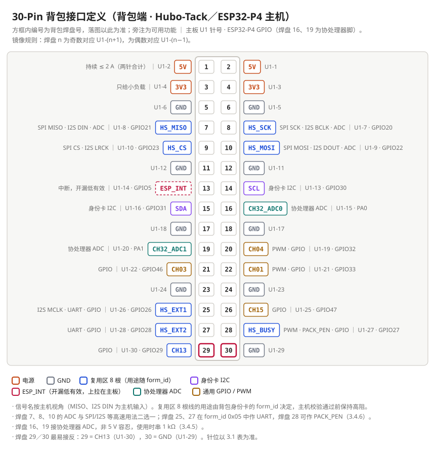

[English](./README.md) | 简体中文

# hubo-backpack-spec

**Hubo-Tack 30-Pin 背包**接口规范：针位、机械、供电、身份卡。背包是插在主机背面 30-Pin 连接座上的扩展板；三类主机使用同一连接座：Hubo-Tack（ESP32-P4，本规范的基准主机）、S3 主机（ESP32-S3）、CM 系列（开发中）。

## 30-Pin 接口一览

图中编号是**背包焊盘号**（落图以此为准），与主板 `U1` 针号镜像：焊盘 n 为奇数对应 `U1`-(n+1)，为偶数对应 `U1`-(n−1)。功能按 Hubo-Tack（ESP32-P4）主机。S3 主机与 CM 系列（开发中）使用同一连接座，电源与地针位一致，功能差异见 [SPEC-003 1.4](./docs/zh-CN/30pin-backpack-spec.md)。

| 针（背包焊盘） | 用途 | 要点 |
|---|---|---|
| 1、2 | `5V` | 背包主电源，持续 ≤ 2 A（3 A 只作短时）。主板到 30-Pin 之间**没有保险丝或限流**，背包短路会直接拉垮主板电源（模板已带电子保险丝） |
| 3、4 | `3V3` | 只给身份卡、上下拉等小负载（上限见 SPEC-003 3.3.2）；射频、LED、功放等一律接 `5V` 自行稳压 |
| 7～10、25、27～29 | 复用区 8 根 | 可作 SPI、I2S、UART、PWM、GPIO，焊盘 7、8、10 还可作 ADC；**具体用途由身份卡里的 `form_id` 决定**，主机识别前保持高阻 |
| 14、15 | 身份卡 I2C（`SCL`、`SDA`） | 身份卡地址 0x50～0x57，DIY 用 0x57；其他 I2C 器件须避开这 8 个地址；上拉在主板，背包不贴 |
| 13 | `ESP_INT` | 中断，开漏、低有效，上拉在主板 |
| 16、19 | 协处理器 ADC | 非 5 V 容忍，使用时串 1 kΩ |
| 20、21、22、26 | 通用 GPIO / PWM | 默认悬空 |
| 5、6、11、12、17、18、23、24、30 | `GND` | — |

> **布局：** 对外插拔接口（USB-C、HDMI、RJ45、SMA、按键等）须放在排针对侧的右板边，排针一侧不放；详见 SPEC-003 2.11～2.14。

> **注意：** 焊盘 29 = `CH13`、焊盘 30 = `GND`，末两针最易接反。完整定义以 [SPEC-003 3.1 针位表](./docs/zh-CN/30pin-backpack-spec.md) 为准。

## 规范文档

以中文版为准，英文版逐条对应翻译。

| 规范 | English | 简体中文 |
|---|---|---|
| 30-Pin 背包规范（SPEC-003 公开版 V1.6）：机械、针位、供电、信号、原理图与 Layout 规则、投板清单 | [docs/en/30pin-backpack-spec.md](./docs/en/30pin-backpack-spec.md) | [docs/zh-CN/30pin-backpack-spec.md](./docs/zh-CN/30pin-backpack-spec.md) |
| 背包身份卡规范（SPEC-004 公开版 V2.2）：I2C 地址规划、12 字节描述符、`form_id`、`product_id` 规则、烧写 | [docs/en/id-card-spec.md](./docs/en/id-card-spec.md) | [docs/zh-CN/id-card-spec.md](./docs/zh-CN/id-card-spec.md) |
| PCB Layout 通用规范（SPEC-005 公开版 V0.12，草案）：信号分级、USB／SPI／MIPI／SDIO／时钟／射频走线、全部网络的基础走线规则、ESP32-P4／S3／C3 附录 | [docs/en/pcb-layout-spec.md](./docs/en/pcb-layout-spec.md) | [docs/zh-CN/pcb-layout-spec.md](./docs/zh-CN/pcb-layout-spec.md) |

章节与条款编号（如 `SPEC-003 3.4.1`、`SPEC-004 2.2`）保持稳定，hubo-backpack-skill 的检查脚本会引用它们。

## DIY 背包与 product_id

- **DIY 背包必须使用 0x57 烧录版身份卡**（`AT24C02`，`A0`～`A2` 全部接 `3V3`，写入 12 字节描述符）。0x50～0x56 为官方型号保留。
- **DIY 号段：`0xF000`～`0xFFFE`。** 自用、不保证全局唯一、无需申请。`0x0000`、`0xFFFF` 禁用。
- **需要全局唯一的 `product_id`？** [用 product-id 申请模板提交 Issue](https://github.com/hubosmart/hubo-backpack-spec/issues/new?template=product-id-request.md)。
- 身份卡镜像用 hubo-backpack-skill 中的 `idcard_image.py` 生成；烧写步骤见身份卡规范第五章。

## 相关仓库

- [hubo-backpack-skill](https://github.com/hubosmart/hubo-backpack-skill)：让 AI Agent 按这些规范在 KiCad 中设计背包的技能（入口）。
- [hubo-backpack-template](https://github.com/hubosmart/hubo-backpack-template)：30-Pin 背包空白 KiCad 模板。

## 许可证

[CC BY 4.0](./LICENSE)。复用本材料时请署名：`Hubosmart, Hubo-Tack 30-pin backpack spec`。

规范按现状提供。标注“待实测”的数值为暂定值，本文不构成任何质量或合规保证。
