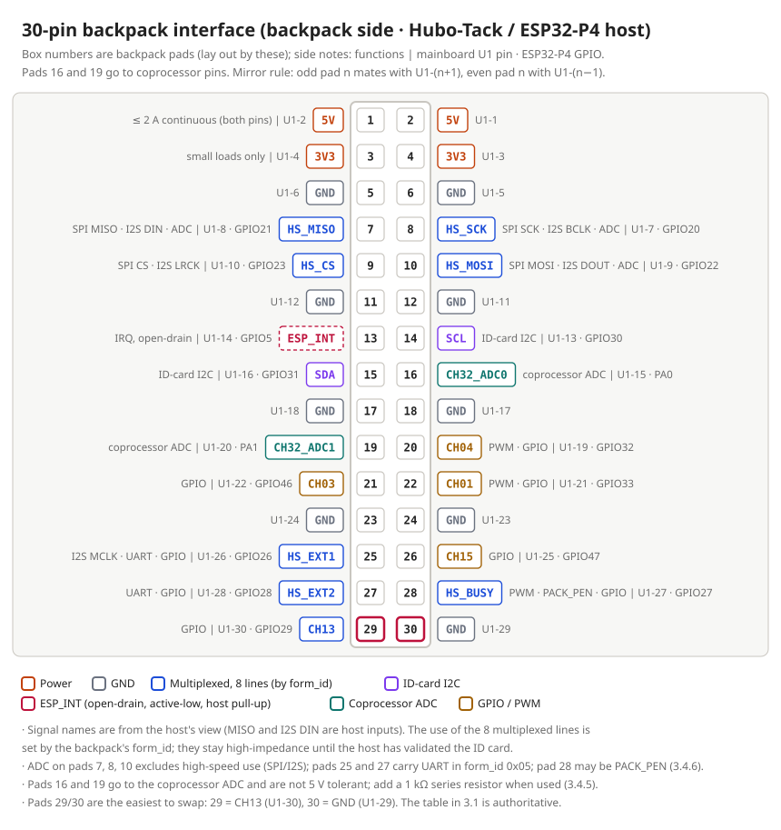
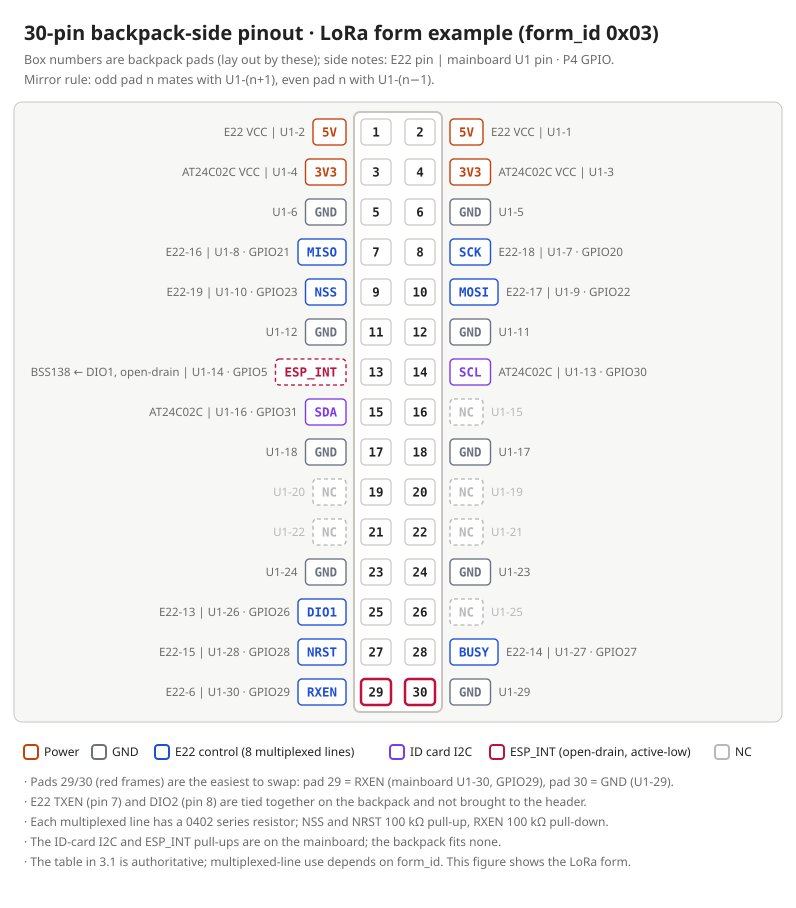

> Translated from the Chinese version; if they differ, the Chinese version prevails.

# Hubo-Tack 30-Pin Backpack Specification (SPEC-003 Public Edition V1.6)

> **Basis:** Every newly designed Hubo-Tack 30-Pin backpack must follow this specification for outline, mounting holes, 30-pin header position and interface usage. Any deviation must be listed item by item, with reasons, in that board's design document.
>
> This is the public edition of the internal specification SPEC-003 V1.6. Section and clause numbers are kept unchanged; internal-process clauses are not part of the public edition, and their numbers are marked "(Not included in this public edition)". For the ID card, see the [SPEC-004 public edition](./id-card-spec.md).

## Revision history

(Not included in this public edition)

---

## 1. Scope and conventions

### 1.1 Scope

This specification applies to all 30-Pin backpacks that plug into the 30-pin connector `U1` of the following three kinds of host: Hubo-Tack (ESP32-P4, the reference host of this specification), the S3 host (ESP32-S3), and the CM series (in development). Pin positions, mechanics and power values are written for Hubo-Tack; differences on the other hosts are given in 1.4. Backpacks designed to the older S3 30-Pin definition are out of scope.

### 1.2 Coordinate convention

All coordinates in this specification use the **board center as the origin** (set as the drill/place origin in KiCad), in mm, **viewed from the top side**, X positive to the right, Y positive downward (same as KiCad).

### 1.3 Pin numbering convention

The 30-pin interface is always drawn using **backpack pad numbers**; the mainboard `U1` pin numbers are only used to cross-check with mainboard documents. The two are mirror-mated: an odd backpack pad n mates with `U1` pin n+1, an even pad n mates with `U1` pin n−1.

> **Note:** When using material that quotes `U1` pin numbers, convert them to backpack pad numbers first; never copy pin numbers directly.

### 1.4 Host support

The three kinds of host use the **same 30-pin connector**: the connector type and pad positions are identical; the `5V` (pads 1, 2), `3V3` (pads 3, 4) and nine `GND` pins are at the same positions; all signals are 3.3 V level. A backpack built to this specification will therefore not be damaged when plugged into any of them, but functions differ, as the table below shows. The CM series is in development; the release version prevails.

| Item | Hubo-Tack (ESP32-P4) | S3 host (ESP32-S3) | CM series (in development) |
|---|---|---|---|
| `3V3` power-up | Present as soon as the host is on; also present with USB only (see 3.2.4) | Present as soon as the host is on; whether it is present with USB only has not been measured | Switched on by firmware after the host boots: early in boot only `5V` is present and `3V3` is not; with USB only there is no `3V3` |
| 8 multiplexed lines (pads 7–10, 25, 27–29) | Driven directly by the ESP32-P4; SPI, I2S, UART, PWM, GPIO | Connected to the mainboard coprocessor, not to the ESP32-S3; SPI, PWM and GPIO go through the coprocessor, and the related firmware support is still being completed; **I2S is not supported** | SPI, I2S and GPIO supported; the UART needed by `form_id` 0x05 is **not supported** |
| ADC on pads 7, 8, 10 | Yes | Through the coprocessor | **None** |
| PWM (pads 20, 22, 28) | Yes | Pads 20 and 22 are coprocessor hardware PWM; pad 28 is software PWM | **Pad 28 only** |
| Coprocessor ADC (pads 16, 19) | Series resistors on the mainboard side | **No series resistors on the mainboard side**; the backpack must add 1 kΩ in series per 3.4.5 | Same as Hubo-Tack |
| ID card I2C | The mainboard has 4.7 kΩ pull-ups; the full recognition firmware is in development and currently only probes 0x50 | **The mainboard has no pull-ups and the firmware only probes 0x50**: a backpack built to this specification currently **cannot be recognized** on the S3 host | The mainboard has pull-ups; recognition happens after the host switches on `3V3` |
| Multiplexed zone before recognition | High impedance (see 3.4.2) | High impedance not guaranteed (the coprocessor may drive it) | On some models pads 8 and 10 have pull-ups on the host side, so they are not high impedance |
| `ESP_INT` | Can wake the host | Available | Interrupt available; wake-up for `form_id` 0x05 is **not supported** |

**Backpack design requirements:** the CM series has a window in which `5V` is present before `3V3`. Therefore, until `3V3` is present, a backpack **must not** drive the multiplexed zone, the ID card I2C or `ESP_INT`, and must not back-feed `3V3` through signal lines (the same principle as 3.3.5, "no back-feeding power"). The S3 host and the CM series guarantee less than 3.4.2 about the multiplexed zone before recognition, so inputs of backpack-side devices must have a defined level under all conditions.

---

## 2. Mechanical specification

| Clause | Requirement |
|---|---|
| 2.1 Outline | Rectangle 83.0 × 40.0 mm, four corners R2.0. Board outline X −41.5 to 41.5, Y −20.0 to 20.0. No notches |
| 2.2 Thickness and layers | Board thickness 1.6 mm. **2 or 4 layers as needed**; state the reason in the design document: use 4 layers when RF, impedance-controlled lines or high-speed signals need a complete reference ground; otherwise 2 layers are fine |
| 2.3 Mounting holes | 4 × M2 at (±39.5, ±18.0); plated hole diameter 2.0 mm, pad 3.0 mm, connected to `GND`; no stencil opening |
| 2.4 30-pin header | Designator `H1`, mounted on the **bottom side**, 2 × 15, 2.0 mm pitch, vertical SMD male header, footprint `HDR-SMD_30P-P2.00-V-M-R2-C15-LS6.5`, LCSC part number `C54930122` |
| 2.5 Header position | Pad 1 at (−31.63, −13.43); odd pads in column X = −31.63, even pads in column X = −36.13 (column spacing 4.50); row pitch 2.00; pads 29 and 30 at Y = 14.57. Pad size 3.0 × 0.89 mm |
| 2.6 Top-side height limit | Component tops no more than **3.9 mm** above the board surface (to be measured) |
| 2.7 Bottom-side height limit | Except for the 30-pin header, components no more than **1.7 mm** above the bottom surface (to be measured) |
| 2.8 Header protrusion | Header pins protrude 6.09 mm below the bottom surface |
| 2.9 Edge devices | Connectors must exit from the **side**, never downward; board-edge devices (such as SMA) must not extend beyond the enclosure opening, and the protrusion must be stated in the design document |
| 2.10 Keying | The 30-pin interface must have mechanical keying to prevent reverse insertion (pads 16 and 19 map to the coprocessor ADC, which is not 5 V tolerant) |
| 2.11 Connector placement | External connectors that are plugged in or loaded by a cable (USB-C, HDMI, RJ45, SMA, buttons, DIP switches and the like) **must** be on the right board edge (positive X), opposite the header; no external connector may be on the header side (left edge). Where the enclosure forces one onto the top or bottom edge (such as a TF card socket), state its position and the reason in the design document |
| 2.12 Insertion force | A plug or heavy connector that extends beyond the board edge must have its body supported by the enclosure, so the enclosure takes the insertion force; the solder joints must not carry it alone |
| 2.13 Indicators and controls | The usual pose is the whole unit lying flat with the backpack side down: buttons and switches the user operates must be reachable from a side, never only from the backpack's outer face; status LEDs must be light-piped to a side, or seen through a window in the enclosure that stays visible when the unit lies flat |
| 2.14 Internal cable connectors | Connectors whose cables stay inside the enclosure (such as a camera FPC or a GNSS U.FL) should be on the top edge, away from the external-connector area on the right edge |

> **Note:** The values in 2.6 and 2.7 have not yet been checked against the height of components on the back of the mainboard, the mating gap between the two boards, or the enclosure cavity. This clause will be revised with measured values once that check is done.

---

## 3. 30-pin interface specification

### 3.1 Pin definition

| Backpack pad | Mainboard `U1` | Mainboard signal | ESP32-P4 GPIO | Backpack-side use |
|---:|---:|---|---|---|
| 1, 2 | 2, 1 | `5V` | — | Main power for the backpack |
| 3, 4 | 4, 3 | `3V3` | — | Small loads such as the ID card and pull-up/pull-down resistors |
| 5, 6, 11, 12, 17, 18, 23, 24, 30 | 6, 5, 12, 11, 18, 17, 24, 23, 29 | `GND` | — | Ground |
| 8 | 7 | `HS_SCK` | `GPIO20` | Multiplexed zone |
| 7 | 8 | `HS_MISO` | `GPIO21` | Multiplexed zone |
| 10 | 9 | `HS_MOSI` | `GPIO22` | Multiplexed zone |
| 9 | 10 | `HS_CS` | `GPIO23` | Multiplexed zone |
| 25 | 26 | `HS_EXT1` | `GPIO26` | Multiplexed zone |
| 28 | 27 | `HS_BUSY` | `GPIO27` | Multiplexed zone (function depends on `form_id`, see 3.4.6) |
| 27 | 28 | `HS_EXT2` | `GPIO28` | Multiplexed zone |
| 29 | 30 | `CH13` | `GPIO29` | Multiplexed zone |
| 14 | 13 | ID card `SCL` | `GPIO30` | ID card bus (other I2C devices must avoid 0x50–0x57, see SPEC-004) |
| 15 | 16 | ID card `SDA` | `GPIO31` | ID card bus (same as above) |
| 13 | 14 | `ESP_INT` | `GPIO5` | Interrupt output, open-drain, active low |
| 16 | 15 | `CH32_ADC0` | Coprocessor `PA0` | Left floating by default |
| 19 | 20 | `CH32_ADC1` | Coprocessor `PA1` | Left floating by default |
| 20 | 19 | `CH04` | `GPIO32` | Left floating by default |
| 21 | 22 | `CH03` | `GPIO46` | Left floating by default |
| 22 | 21 | `CH01` | `GPIO33` | Left floating by default |
| 26 | 25 | `CH15` | `GPIO47` | Left floating by default |

> **Note:** The last two pins are the easiest to swap: backpack pad 29 = `CH13` (mainboard `U1-30`), backpack pad 30 = `GND` (mainboard `U1-29`).

*30-pin backpack interface (backpack pad numbers); functions are for the Hubo-Tack (ESP32-P4) host; for other hosts see 1.4. Side notes give the functions available on each pin (SPI, I2S, UART, PWM, ADC, I2C, interrupt), the mainboard `U1` pin and the ESP32-P4 GPIO. The use of the 8 multiplexed lines is set by `form_id`; the table above is authoritative.*

### 3.2 Power supply

> **Note:** The values in this section are for Hubo-Tack; for differences on the S3 host and the CM series see 1.4.

| Clause | Content |
|---|---|
| 3.2.1 5 V source | `U1-1`/`U1-2` connect to the mainboard `+5V` rail (about 4.98 V), obtained by boosting on the mainboard's battery side. The same rail also feeds mainboard loads such as the audio amplifier and the top-board backlight |
| 3.2.2 3V3 source | `U1-3`/`U1-4` connect to the mainboard `+3.3V` rail (about 3.28 V on battery, about 3.13 V on USB only). The same rail also feeds mainboard loads such as the wireless module, sensors and memory card |
| 3.2.3 No isolation | Between the mainboard and the 30-pin interface there is **no** fuse, current limit, load switch or eFuse, and firmware **cannot** switch off power to the backpack on its own. A short circuit or overload on the backpack pulls down the mainboard supply rail directly |
| 3.2.4 Power states | See the table below |

| Condition | `5V` (pads 1, 2) | `3V3` (pads 3, 4) |
|---|---|---|
| Battery installed, power key not pressed | Off | Off |
| Battery installed, powered on | On | On (3.28 V) |
| USB only (no battery, or not powered on) | **Off** | On (about 3.13 V, sharing a budget of about 1 A with the rest of the mainboard's 3V3 loads) |

### 3.3 Backpack power rules

| Clause | Requirement |
|---|---|
| 3.3.1 5 V current | Backpack `5V` **continuous ≤ 2 A** (to be measured). 3 A is only a short-term value, and only with battery voltage no lower than about 3.5 V and the mainboard amplifier not at high power. The header has only 2 `5V` pins, rated at 1.5 A per pin, so 3 A has no margin; the mainboard has no hardware current limit to enforce this cap |
| 3.3.2 3V3 current | Backpack `3V3` **≤ 50 mA** (to be measured), used only for the ID card, pull-up/pull-down resistors, level logic and other small loads. **Judge by current, not by device type**: logic, sensing chips and small MCUs totaling ≤ 50 mA may use `3V3`; the design document lists the estimated current, and it is measured on the finished board |
| 3.3.3 Load allocation | RF modules, LEDs, amplifiers, motors, codecs and the like **always use `5V`**; if another voltage is needed, the backpack regulates it itself from `5V`. `3V3` is used only for the small loads listed in 3.3.2 |
| 3.3.4 Only 3V3 present | The backpack must tolerate the state "`3V3` present, `5V` absent": circuits powered from `5V` must not back-feed the mainboard through IO or pull-ups when unpowered, and must not pull the multiplexed zone to any level other than a defined one |
| 3.3.5 No back-feeding | The backpack must not send power back onto `5V` or `3V3` (for example with its own battery or external supply). If this is truly necessary, add an ideal diode or switch and have it reviewed (the mainboard has no isolation, so back-fed power goes straight onto the mainboard 5V rail) |
| 3.3.6 Hot-plug inrush | Large capacitance at the backpack `5V` input causes inrush on insertion; state the total `5V` capacitance in the design document and measure the mainboard `5V` droop during acceptance testing |

### 3.4 Signal requirements

| Clause | Requirement |
|---|---|
| 3.4.1 Series resistors on the multiplexed zone | Reserve one 0402 series resistor on each of the 8 multiplexed-zone lines, placed close to the header; **populate with 0 Ω**, keeping the pads so the value can be changed during debugging |
| 3.4.2 Default state of the multiplexed zone | Until the host has validated the descriptor or matched the lookup table, the multiplexed zone stays high-impedance. Inputs of backpack-side devices must have a defined level during this time; add pull-up/pull-down resistors as needed |
| 3.4.3 ID card I2C | Pull-ups are provided by the mainboard (4.7 kΩ); the **backpack must not fit pull-ups**; put 100 Ω in series with each of `SCL` and `SDA` |
| 3.4.4 `ESP_INT` | Open-drain output, active low; the **pull-up is on the mainboard**, the backpack must not fit one; polarity is given by descriptor `flags.bit0` or by address lookup (see SPEC-004 2.2) |
| 3.4.5 Floating pads | Pads marked "left floating by default" in 3.1 keep their pads and leave the nets floating. To use `CH32_ADC0`/`CH32_ADC1` (pads 16 and 19), add 1 kΩ in series as current limiting |
| 3.4.6 Use of the multiplexed zone | The 8 multiplexed-zone lines (backpack pads 7–10, 25, 27–29, including pad 28 / mainboard `U1-27`) are general-purpose GPIO, and **their function is decided by the backpack's `form_id`**, stated in each backpack's design document. Example: in the LoRa form, pad 28 = RF module `BUSY`. **The only exception is `PACK_PEN`**: if the backpack uses pad 28 as its own enable pin, the descriptor must give `flags.bit1 = 1`, and after the descriptor is validated the host configures that pin as an output driven high, regardless of `form_id`. The enable target may be the backpack power (it must then be gated through a load switch) or a function (such as an amplifier enable); the backpack-side enable pin must have a pull-down so it is off by default before the host drives it high. The host keeps that pin high-impedance until the descriptor is validated |

*Example: how a LoRa-form (`form_id` 0x03) backpack is actually wired. Side notes give the RF module pin, mainboard `U1` pin and ESP32-P4 GPIO.*

---

## 4. ID card specification

For address planning, descriptor format and `product_id` rules of the ID card, see the [SPEC-004 public edition](./id-card-spec.md). **DIY backpacks must use the 0x57 programmed ID card.**

| Clause | Requirement |
|---|---|
| 4.1 Device | `AT24C02` family (SOIC-8 or TSSOP-8; use TSSOP-8 on the bottom side to meet the 1.7 mm bottom height limit of 2.7), baseline part `AT24C02C-SSHM-T` |
| 4.2 Address | 0x50–0x56 are reserved for official models and must not be used by DIY backpacks; **DIY backpacks always use the 0x57 programmed version** (`A0`–`A2` all tied to `3V3`). Address table and `product_id` rules follow SPEC-004 |
| 4.3 Power | Backpack pads 3 and 4 (`3V3`) |
| 4.4 Write protect | `WP` is pulled up to `3V3` through 10 kΩ and brought out to a test point, silkscreened "WP"; when programming, short (pull low) the test point to `GND`. The test point must remain reachable with the enclosure fitted |
| 4.5 Content | The 0x57 programmed version holds a 12-byte descriptor: `signature = "HuBo"`, `spec_ver`, `form_id`, `product_id`, `hw_ver`, `flags`, `crc16` (CRC-16/CCITT-FALSE, multi-byte fields little-endian); format in SPEC-004 3.6. The descriptor area is `0x00`–`0x0F`; if the user area (`0x10`–`0xFF`) is written, its content is defined by the backpack's design document (SPEC-004 2.4.6) |
| 4.6 `form_id` | Values are listed in SPEC-004 3.7. The programmed version writes `form_id` into the descriptor |
| 4.7 No active devices | Between the ID card `SCL`/`SDA` and the 30-pin interface, nothing but the 100 Ω series resistors may be inserted — no active devices (level shifters, isolators, buffers, analog switches). The ID card is powered from the host `3V3` and must be readable even when the backpack's own power is off (`PACK_PEN` low); if an active device breaks enumeration, it cannot be diagnosed from software, and the host will only conclude "no backpack inserted" |
| 4.8 Placement | Should be near the header's ID-card I2C pads (pads 14, 15) to keep `SCL` and `SDA` short; place the `WP` test point where it can be reached with the enclosure fitted, per 6.4.3 |

> **Note:** Every backpack must be programmed with its own descriptor; do not reuse someone else's or a baseline board's content. If `form_id` does not match the actual form, the host keeps the multiplexed zone high-impedance and the backpack's function fails.

---

## 5. Schematic specification

| Clause | Requirement |
|---|---|
| 5.1 Layout | Arrange by functional block with a title on each block; **draw wires inside a block** and use labels only between blocks. A schematic that relies on labels alone without drawn wires is unacceptable |
| 5.2 Labels | Name signal nets with **global labels** (no hierarchical prefix). Attach labels at wire ends or on short stubs; they **must not sit mid-wire** (the wire would run through the label text) |
| 5.3 Power naming | Power nets are uniformly `+5V`, `3V3`, `GND`; RF nets keep `ANT` (module side) and `SIG` (antenna connector side) |
| 5.4 Junctions | Draw a junction at every T connection (including a power symbol or label hung on a wire corner) |
| 5.5 Text | Designators, values and labels must not overlap each other or cover wires and symbols; the designator of the power flag `#FLG` is hidden |
| 5.6 BOM fields | Fill the (hidden) `LCSC` field for every placed component, and verify the part number's model and stock on lcsc.com; mark non-placed parts DNP; set mounting holes to be excluded from the BOM |
| 5.7 Verification | ERC with 0 violations; check the netlist **pin by pin** against the wiring table; schematic-to-PCB consistency check with 0 items |

---

## 6. Layout specification

### 6.1 Layers and coordinates

| Clause | Requirement |
|---|---|
| 6.1.1 Layer names | 4-layer board: L1 `TopLayer`, L2 `GND` (internal ground plane, not split), L3 `PWR` (internal power plane, may be split), L4 `BottomLayer`. When L3 is also a complete ground (power routed entirely on outer layers) name it `GND2`. 2-layer board: `TopLayer`, `BottomLayer`. In the KiCad board setup, fill in each layer's thickness and Dk according to the stackup, and put the impedance and stackup notes on the `Cmts.User` layer outside the board outline |
| 6.1.2 Origin | Set the drill/place origin at the board center; production files (Gerber, drill, placement) are exported with this origin |

### 6.2 Internal planes and vias

6.2.1 to 6.2.4 apply to 4-layer boards only; on 2-layer boards, a large ground pour on the bottom layer replaces the internal planes, and signal lines must not cut the bottom ground into islands.

| Clause | Requirement |
|---|---|
| 6.2.1 Split line width | `PWR` layer split lines **10–20 mil** (0.254–0.508 mm) |
| 6.2.2 Signal vias | **Signal vias must not sit on a split line** (a clearance hole joined to the split gap counts as sitting on it) |
| 6.2.3 Crossing a split | Outer-layer signal lines must not cross a `PWR` layer split gap |
| 6.2.4 Stitching vias | Place GND stitching vias preferably inside the GND region beside a split line. When a via sits on or touches a split line, confirm each one: it must not create a narrow neck in the current path of the power plane (acceptable only on an unloaded branch), and there must be a nearby return path on both sides of the split |
| 6.2.5 High-speed layer changes | For high-speed lines of the multiplexed zone (`U1` 7–10), place one GND return via within ≤ 1 mm of each signal via; each GND pad gets its own via |
| 6.2.6 Hole to inner-layer copper | Via barrel to other-net inner-layer copper ≥ 0.2 mm; through-hole barrel ≥ 0.3 mm |
| 6.2.7 Stitching via spacing | In the 1.5 mm band along the board edge, GND stitching via spacing ≤ λ/20 (17.3 mm at 493 MHz); fence RF lines with GND vias along both sides |

### 6.3 RF (backpacks with RF)

| Clause | Requirement |
|---|---|
| 6.3.1 Impedance | RF lines are designed as 50 Ω single-ended; platform, stackup, and width/spacing are determined per 6.5 and written into the design document |
| 6.3.2 Matching network | Reserve a π matching network in front of the antenna connector (1 series position, 2 shunt positions, 0603); default series 0 Ω, shunt not populated, with values set after prototype measurement |
| 6.3.3 Edge SMA | When the metal flange sits at the board edge, the **outer end of the signal pad is ≥ 2 mm from the board edge**; ground pads share GND with the flange and may be close to the edge (≥ 0.3 mm). Confirm the pin protrusion length for the exact part used (parts with the same name from different makers may differ by a factor of two) |
| 6.3.4 Under the module | Route no signal lines on the top layer directly under the body of an RF module |

### 6.4 Other

| Clause | Requirement |
|---|---|
| 6.4.1 Edge clearance | Copper and pads ≥ 0.3 mm from the board outline (JLCPCB routing) |
| 6.4.2 Silkscreen | Designator text height **≥ 1.0 mm**, line width ≥ 0.15 mm, not over pads, not off the board, adjacent to its component; put it in the `.kicad_dru` so DRC checks it |
| 6.4.3 Test points | Test points that need factory operation (such as `WP`) get silkscreen labels, and must remain reachable with the enclosure fitted |
| 6.4.4 3D models | Attach 3D models to all components and check pin-1 orientation in a render; run an assembly interference check with the enclosure |
| 6.4.5 Indicator LED | The power LED connects to `5V` (lit means the backpack's main power is present), not to `3V3` |

### 6.5 Impedance control (backpacks with RF, high-speed differential pairs or USB)

Line width and spacing of impedance-controlled lines **may only be derived from the PCB manufacturer's stackup parameters and that manufacturer's impedance calculator**; do not use the EDA default stackup, a stackup from an evaluation-board file, or a formula estimate (results of a formula estimate and a 2D field solver can differ by more than ten ohms).

| Clause | Requirement |
|---|---|
| 6.5.1 Platform and stackup | The design document states the PCB fabrication platform, layer count and thickness, copper weight and stackup model. Default: JLCPCB 4 layers 1.6 mm, outer 1 oz, inner 0.5 oz, stackup `JLC04161H-3313` (same as the Hubo-Tack mainboard). When another platform is used (such as HQ PCB), recompute all impedance lines with that platform's standard stackup and impedance calculator, and **do not reuse the values in 6.5.3** |
| 6.5.2 Target impedance | RF 50 Ω single-ended; USB 2.0 90 Ω differential; HDMI TMDS, MIPI D-PHY/CSI, LVDS and Ethernet 100 Ω differential. Tolerances follow the interface specification or the chip vendor's layout guide and are written into the design document |
| 6.5.3 Parameter table | See the table below. A stackup model name may stay the same while its parameters are updated (the dielectric constant of JLCPCB 3313 changed from 4.05 to 4.1; 3313 replaced 2313), so **before sending each project to fabrication, recompute once in the calculator using the "check point"**; a different result means the stackup has been updated, all impedance lines must be recomputed and this table revised |
| 6.5.4 Adjustment | When the target impedance or stackup changes, solve in the calculator following the "adjustment rules" below: first fix one quantity from the routing conditions (differential spacing is set by pin pitch and channel width), then let the calculator solve the other (line width), and write the result into the design document and the EDA net class |
| 6.5.5 Implementation | Line width, differential width and differential spacing in the EDA net class match the design document; impedance lines stay on a single layer throughout, reference a complete GND, and do not cross splits (6.2.3); layer changes get return ground vias per 6.2.5 |
| 6.5.6 Breakout narrowing | In QFN/BGA breakout areas the intra-pair spacing may be narrowed: each segment ≤ 1.5 mm long, intra-pair center distance ≥ 0.30 mm; list the narrowed segments in the design document |
| 6.5.7 Ordering | Tick impedance control and choose the same stackup as in 6.5.1; state in the remarks the layer of the impedance lines, target impedance, line width and spacing; attach calculator screenshots to the design document |

**Parameter table (JLCPCB `JLC04161H-3313`, 4 layers 1.6 mm, outer 1 oz / inner 0.5 oz, with solder mask)**

| Target | Mode | Impedance layer / reference layer | Line width | Spacing | Source |
|---|---|---|---|---|---|
| 50 Ω | Single-ended coplanar (RF) | L1 / L2 | 0.15 mm | 0.254 mm (10 mil) to the pour on both sides | JLCPCB calculator |
| 90 Ω | Outer-layer differential | L1 / L2 | 6.6 mil (0.168 mm) | 12.58 mil (0.320 mm) | JLCPCB calculator (domestic edition), 2026-10-03 |
| 100 Ω | Outer-layer differential | L1 / L2 | 5.1 mil (0.1295 mm) | 10.48 mil (0.266 mm) | Same as above |

- With L4 referencing L3, the stackup is symmetric top and bottom, and the same values apply;
- Stackup parameters (2026-10-03, jlcpcb.com/impedance): L1 copper 0.035 mm; 3313 prepreg 0.0994 mm, Dk 4.1; core 1.265 mm, Dk 4.6; solder mask Dk 3.8;
- Check point: in the calculator choose this stackup, "differential impedance (outer layer)", L1 referencing L2, 100 Ω, spacing 10.48 mil; the result should be a line width of 5.1 mil;
- Domestic-edition calculator: the `tools.jlc.com` impedance calculator; in the international edition (jlcpcb.com/pcb-impedance-calculator) the first recommended stackup is `JLC04161H-3313A` (two prepreg sheets, dielectric about twice as thick); switch manually to `JLC04161H-3313`, otherwise the line widths are completely different.

**Adjustment rules** (all else equal)

| Change | Impedance | Note |
|---|---|---|
| Wider line | Decreases | The most commonly used adjustment |
| Larger differential spacing | Differential impedance increases | Coupling weakens; after increasing spacing the line must be widened accordingly to return to the same impedance |
| Thicker dielectric (changing stackup) | Increases | The same impedance needs a wider line; `3313A` is thicker than `3313`, so line width is about double |
| Higher dielectric constant | Decreases | Determined by the board material, fixed by the chosen stackup |
| Solder mask coverage | Decreases by about 2–4 Ω (estimate) | The calculator distinguishes "with / without solder mask"; choose "with" for outer layers |
| Thicker copper | Decreases slightly | Outer 1 oz is the default |
| Inner layer (stripline) | Clearly lower than outer layer at the same width | An inner-layer line for the same impedance is narrower and must be calculated separately |
| Coplanar pour closer | Decreases | A coplanar RF waveguide is tuned by the "spacing to pour" |

### 6.6 Routing rules

| Clause | Requirement |
|---|---|
| 6.6.1 Basic rules | All traces follow Chapter 10 of [SPEC-005](./pcb-layout-spec.md) (corners, trace width and spacing, vias, pad exits, power trace width and so on); where it conflicts with this specification, this specification prevails |
| 6.6.2 Graded execution | The design document lists the signal grades involved on the board (SPEC-005 1.2); routing, vias, spacing and length matching follow the corresponding chapters of SPEC-005; where it conflicts with this specification, this specification prevails |

---

## 7. Enclosure fit (3D-printed top cover)

| Clause | Requirement |
|---|---|
| 7.1 Mounting | The 4 M2 holes are fixed to the mainboard through standoffs; screws pass from the top of the cover through the enclosure and the backpack board into the standoffs; the enclosure bottom is open |
| 7.2 Clearance | Board edge to inner wall 0.3 mm; tallest component to the inner surface of the top plate 1.0 mm; in the assembly check, the minimum clearance of each component is ≥ 0.2 mm with no interference |
| 7.3 Openings | Slots with reinforcement for board-edge devices; light-transmitting holes for indicator LEDs; holes for test points that need operation |

---

## 8. Pre-fabrication checklist

| # | Check item | Result |
|---:|---|---|
| 1 | Outline, mounting holes, 30-pin header position, and connector and indicator placement (2.11–2.14) match Chapter 2 | ☐ |
| 2 | Top and bottom height limits meet 2.6 and 2.7 | ☐ |
| 3 | 30-pin usage matches 3.1; the last two pins are not swapped; `5V` and `3V3` loads meet 3.3 | ☐ |
| 4 | ID card address, write protect and descriptor comply with Chapter 4 | ☐ |
| 5 | ERC 0 violations; netlist checked pin by pin; schematic-to-PCB consistency 0 items | ☐ |
| 6 | DRC 0 errors, 0 warnings (or the reason for each exception stated) | ☐ |
| 7 | Signal vias not on split lines; crossings of splits 0; stitching vias confirmed one by one | ☐ |
| 8 | RF matching network and SMA pad distance to the board edge comply with 6.3 | ☐ |
| 9 | All components have 3D models, and the enclosure assembly has no interference | ☐ |
| 10 | BOM part numbers verified on lcsc.com; placement file complete, rotations checked in the JLCPCB preview | ☐ |
| 11 | Impedance lines: platform and stackup written into the design document and recomputed at the check point; line width and spacing match 6.5.3 or the calculator result; narrowed segments listed; impedance control ticked on the order | ☐ |
| 12 | The design document lists the current and trace width of power nets, and the signal grades; the checks in Chapter 9 of [SPEC-005](./pcb-layout-spec.md) have been run and the results written into the design document | ☐ |

---

## 9. References

(Not included in this public edition)
