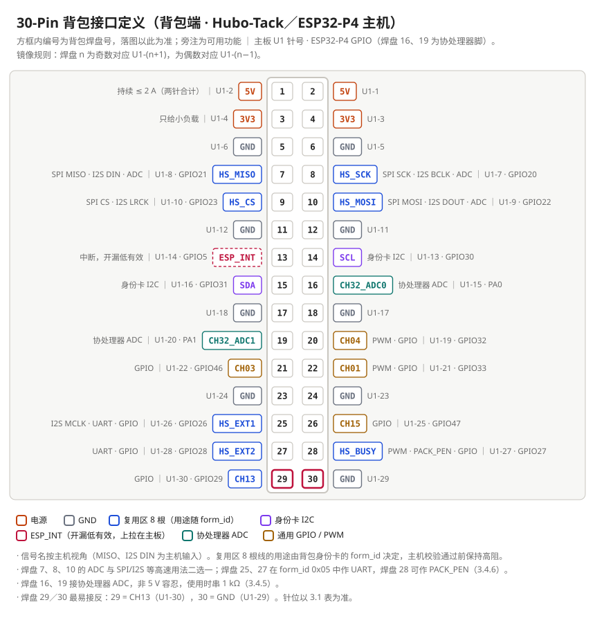
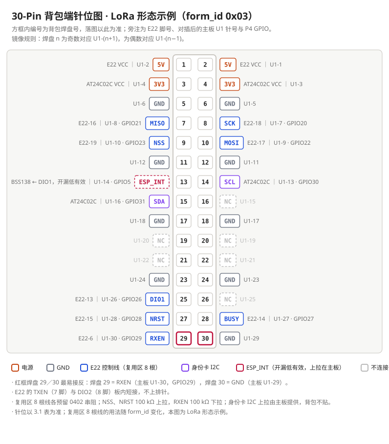

# Hubo-Tack 30-Pin 背包规范（SPEC-003 公开版 V1.6）

> **制定基准：** 凡新设计的 Hubo-Tack 30-Pin 背包，外形、安装孔、30-Pin 排针位置与接口用法须与本规范一致；确需偏离的，须在该板设计文档中逐条写明偏离项与理由。
>
> 本文是内部规范 SPEC-003 V1.6 的公开版，章节与条款编号保持原样；内部流程类条款不随公开版发布，对应编号处标注“（本公开版不含）”。身份卡相关内容见 [SPEC-004 公开版](./id-card-spec.md)。

## 文档修订记录

（本公开版不含）

---

## 一、适用范围与约定

### 1.1 适用范围

本规范适用于插接在以下三类主机 30-Pin 连接座 `U1` 上的全部 30-Pin 背包：Hubo-Tack（ESP32-P4，本规范的基准主机）、S3 主机（ESP32-S3）、CM 系列（开发中）。针位、机械与供电数值按 Hubo-Tack 编写，其他主机的差异见 1.4。按旧版 S3 30-Pin 定义设计的背包不在本规范范围内。

### 1.2 坐标约定

本规范中的坐标均以**板中心为原点**（KiCad 中设为钻孔/坐标原点），单位 mm，**从顶面看**，X 向右为正，Y 向下为正（与 KiCad 一致）。

### 1.3 针号约定

30-Pin 一律按**背包焊盘号**落图；主板 `U1` 针号仅用于与主板文档核对。两者为镜像对插关系：背包焊盘 n 为奇数时对应 `U1` 针 n+1，为偶数时对应 `U1` 针 n−1。

> **注意：** 引用使用 `U1` 针号的资料时，须先换算为背包焊盘号，不得直接照抄针号。

### 1.4 主机支持情况

三类主机使用**同一个 30-Pin 连接座**：连接座型号与焊盘位置相同；`5V`（焊盘 1、2）、`3V3`（焊盘 3、4）和 9 根 `GND` 针位相同；信号均为 3.3 V 电平。因此按本规范做的背包插在任一主机上不会烧，但功能有差异，见下表。CM 系列开发中，以发布时为准。

| 项目 | Hubo-Tack（ESP32-P4） | S3 主机（ESP32-S3） | CM 系列（开发中） |
|---|---|---|---|
| `3V3` 上电 | 开机即有；只插 USB 也有（见 3.2.4） | 开机即有；只插 USB 时有没有未实测 | 主机开机后由固件打开：开机初期只有 `5V`、没有 `3V3`；只插 USB 时没有 `3V3` |
| 复用区 8 根（焊盘 7～10、25、27～29） | ESP32-P4 直接驱动，支持 SPI、I2S、UART、PWM、GPIO | 接的是主板协处理器，而不是 ESP32-S3；SPI、PWM、GPIO 经协处理器，相关固件支持待完善；**不支持 I2S** | 支持 SPI、I2S、GPIO；`form_id` 0x05 所需的 UART **不支持** |
| 焊盘 7、8、10 的 ADC | 有 | 经协处理器 | **无** |
| PWM（焊盘 20、22、28） | 有 | 焊盘 20、22 为协处理器硬件 PWM，焊盘 28 为软件 PWM | **只有焊盘 28** |
| 协处理器 ADC（焊盘 16、19） | 主板侧有串联电阻 | **主板侧无串联电阻**，背包必须按 3.4.5 串 1 kΩ | 同 Hubo-Tack |
| 身份卡 I2C | 主板有 4.7 kΩ 上拉；完整识别固件开发中，目前只探测 0x50 | **主板没有上拉，固件只探测 0x50**：按本规范做的背包目前在 S3 主机上**不能识别** | 主板有上拉；识别在主机打开 `3V3` 之后进行 |
| 识别前的复用区 | 高阻（见 3.4.2） | 不保证高阻（协处理器可能输出） | 部分型号的焊盘 8、10 在主机侧带上拉，不是高阻 |
| `ESP_INT` | 可唤醒主机 | 可用 | 中断可用；`form_id` 0x05 的唤醒**不支持** |

**背包设计要求：** CM 系列存在“`5V` 先于 `3V3`”的窗口。因此背包在 `3V3` 有电之前，**不得**驱动复用区、身份卡 I2C 或 `ESP_INT`，也不得经信号线向 `3V3` 倒灌（与 3.3.5“不得反灌电源”是同一原则）。S3 主机与 CM 系列对复用区识别前状态的保证弱于 3.4.2，背包侧器件的输入须在任何情况下都有确定电平。

---

## 二、机械规范

| 条款 | 要求 |
|---|---|
| 2.1 外形 | 矩形 83.0 × 40.0 mm，四角 R2.0 圆角；板框 X −41.5 ～ 41.5，Y −20.0 ～ 20.0。不开缺口 |
| 2.2 板厚与层数 | 板厚 1.6 mm。**2 层或 4 层按需选择**，在设计文档中写明理由：有射频、阻抗控制线或高速信号需要完整参考地时用 4 层；其余可用 2 层 |
| 2.3 安装孔 | 4 × M2，坐标 (±39.5, ±18.0)；金属化孔径 2.0 mm，焊盘 3.0 mm，接 `GND`；不开钢网 |
| 2.4 30-Pin 排针 | 位号 `H1`，**底面**贴装，2 × 15，间距 2.0 mm，立式 SMD 公针，封装 `HDR-SMD_30P-P2.00-V-M-R2-C15-LS6.5`，立创料号 `C54930122` |
| 2.5 排针位置 | 焊盘 1 位于 (−31.63, −13.43)；奇数焊盘列 X = −31.63，偶数焊盘列 X = −36.13（列距 4.50）；行距 2.00，焊盘 29、30 位于 Y = 14.57。焊盘 3.0 × 0.89 mm |
| 2.6 顶面限高 | 元件顶面高出板面 **≤ 3.9 mm**（待实测） |
| 2.7 底面限高 | 除 30-Pin 排针外，元件高出底面 **≤ 1.7 mm**（待实测） |
| 2.8 排针伸出 | 排针针脚伸出底面 6.09 mm |
| 2.9 出板边器件 | 接口一律从**侧边**出线，不朝下；板边安装器件（如 SMA）不得超出外壳开口，伸出量须在设计文档中写明 |
| 2.10 防呆 | 30-Pin 须有结构防呆，防止插反（焊盘 16、19 对应协处理器 ADC，非 5 V 容忍） |
| 2.11 接口位置 | 需要插拔或受线缆拉力的对外接口（USB-C、HDMI、RJ45、SMA、按键、拨码开关等）**须**放在排针对侧的右板边（X 正向）；排针一侧（左板边）不得放对外接口。受外壳结构所限须放在上、下板边的（如 TF 卡座），在设计文档中写明位置与理由 |
| 2.12 插拔受力 | 伸出板边的公头或较重的接口，须由外壳承托其本体，插拔力由外壳承受，不得只靠焊脚承力 |
| 2.13 指示灯与操作件 | 整机以背包一面朝下平放为主要姿态：需要用户操作的按键、开关须从侧边可及，不得只能从背包外表面操作；状态指示灯须导光到侧边，或在外壳上开平放时仍可看到的透光窗 |
| 2.14 内部线缆座 | 只在外壳内走线的座子（如摄像头 FPC、GNSS 天线 U.FL）宜放在上板边，避开右板边的对外接口区 |

> **注意：** 2.6、2.7 的数值尚未与主板背面元件高度、双板配合间隙、外壳内腔做过实测核对。核对完成后按实测值修订本条。

---

## 三、30-Pin 接口规范

### 3.1 针位定义

| 背包焊盘 | 主板 `U1` | 主板信号 | ESP32-P4 GPIO | 背包侧用法 |
|---:|---:|---|---|---|
| 1、2 | 2、1 | `5V` | — | 背包主电源 |
| 3、4 | 4、3 | `3V3` | — | 身份卡及上下拉等小电流负载 |
| 5、6、11、12、17、18、23、24、30 | 6、5、12、11、18、17、24、23、29 | `GND` | — | 地 |
| 8 | 7 | `HS_SCK` | `GPIO20` | 复用区 |
| 7 | 8 | `HS_MISO` | `GPIO21` | 复用区 |
| 10 | 9 | `HS_MOSI` | `GPIO22` | 复用区 |
| 9 | 10 | `HS_CS` | `GPIO23` | 复用区 |
| 25 | 26 | `HS_EXT1` | `GPIO26` | 复用区 |
| 28 | 27 | `HS_BUSY` | `GPIO27` | 复用区（用途随 `form_id`，见 3.4.6） |
| 27 | 28 | `HS_EXT2` | `GPIO28` | 复用区 |
| 29 | 30 | `CH13` | `GPIO29` | 复用区 |
| 14 | 13 | 身份卡 `SCL` | `GPIO30` | 身份卡总线（其他 I2C 器件地址须避开 0x50～0x57，见 SPEC-004） |
| 15 | 16 | 身份卡 `SDA` | `GPIO31` | 身份卡总线（同上） |
| 13 | 14 | `ESP_INT` | `GPIO5` | 中断输出，开漏、低有效 |
| 16 | 15 | `CH32_ADC0` | 协处理器 `PA0` | 默认悬空 |
| 19 | 20 | `CH32_ADC1` | 协处理器 `PA1` | 默认悬空 |
| 20 | 19 | `CH04` | `GPIO32` | 默认悬空 |
| 21 | 22 | `CH03` | `GPIO46` | 默认悬空 |
| 22 | 21 | `CH01` | `GPIO33` | 默认悬空 |
| 26 | 25 | `CH15` | `GPIO47` | 默认悬空 |

> **注意：** 末两针最易接反：背包焊盘 29 = `CH13`（主板 `U1-30`），背包焊盘 30 = `GND`（主板 `U1-29`）。

*30-Pin 背包接口定义（背包端焊盘号），功能按 Hubo-Tack（ESP32-P4）主机，其他主机见 1.4。旁注为每针可用的功能（SPI、I2S、UART、PWM、ADC、I2C、中断）、主板 `U1` 针号与 ESP32-P4 GPIO；复用区 8 根线的用途由 `form_id` 决定，针位以上表为准。*

### 3.2 供电

> **注：** 本节数值为 Hubo-Tack 的；S3 主机、CM 系列的差异见 1.4。

| 条款 | 内容 |
|---|---|
| 3.2.1 5 V 来源 | `U1-1`／`U1-2` 接主板 `+5V` 轨（约 4.98 V），由主板电池侧升压得到。同一轨上还有主板自身的功放、顶层板背光等负载 |
| 3.2.2 3V3 来源 | `U1-3`／`U1-4` 接主板 `+3.3V` 轨（电池供电时约 3.28 V，仅 USB 供电时约 3.13 V）。同一轨上还有主板的无线模组、传感器、存储卡等负载 |
| 3.2.3 无隔离 | 主板到 30-Pin 之间**没有**保险丝、限流、负载开关或 eFuse，固件也**不能**单独关断背包供电。背包短路或过载会直接拉垮主板电源轨 |
| 3.2.4 有电状态 | 见下表 |

| 工况 | `5V`（焊盘 1、2） | `3V3`（焊盘 3、4） |
|---|---|---|
| 有电池，未按开机键 | 无 | 无 |
| 有电池，已开机 | 有 | 有（3.28 V） |
| 仅插 USB（无电池或未开机） | **无** | 有（约 3.13 V，与主板其余 3V3 负载共用约 1 A 的预算） |

### 3.3 背包供电规则

| 条款 | 要求 |
|---|---|
| 3.3.1 5 V 电流 | 背包 `5V` **持续 ≤ 2 A**（待实测）。3 A 只作短时值，且须电池电压不低于约 3.5 V、主板功放不在大功率工作。排针 `5V` 仅 2 针、单针按 1.5 A 计，3 A 无余量；主板没有任何硬件限流执行该上限 |
| 3.3.2 3V3 电流 | 背包 `3V3` **≤ 50 mA**（待实测），只用于身份卡、上下拉、电平逻辑等小电流负载。**按电流判断，不按器件种类**：合计 ≤ 50 mA 的逻辑、检测芯片与小型 MCU 可接 `3V3`，设计文档列出估算电流，回板实测 |
| 3.3.3 负载分配 | 射频模组、LED、功放、电机、编解码器等**一律接 `5V`**，需要其他电压的由背包从 `5V` 自行稳压；`3V3` 只接 3.3.2 所列小电流负载 |
| 3.3.4 仅 3V3 有电 | 背包须承受“`3V3` 有电、`5V` 无电”状态：由 `5V` 供电的电路断电时，不得经 IO 或上拉向主板倒灌，也不得把复用区拉到确定电平以外的状态 |
| 3.3.5 不得反灌电源 | 背包不得向 `5V`、`3V3` 回送电能（如自带电池、外部供电），确需时须加理想二极管或开关并经评审（主板无隔离，反灌会直接进入主板 5V 轨） |
| 3.3.6 热插拔浪涌 | 背包 `5V` 入口大电容会在插入时造成浪涌；须在设计文档中写明 `5V` 总电容，并在回板验收时实测主板 `5V` 跌落 |

### 3.4 信号要求

| 条款 | 要求 |
|---|---|
| 3.4.1 复用区串阻 | 复用区 8 根线各预留一颗 0402 串阻，靠近排针摆放；**贴 0 Ω**，保留焊盘便于调试时改值 |
| 3.4.2 复用区默认态 | 主机描述符校验通过或查表命中之前，复用区保持高阻。背包侧器件的输入在此期间须有确定电平，按需加上下拉 |
| 3.4.3 身份卡 I2C | 上拉由主板提供（4.7 kΩ），**背包不贴上拉**；`SCL`、`SDA` 各串 100 Ω |
| 3.4.4 `ESP_INT` | 开漏输出、低有效，**上拉在主板**，背包不放上拉；极性由描述符 `flags.bit0` 或地址查表给出（见 SPEC-004 2.2） |
| 3.4.5 悬空焊盘 | 3.1 中标“默认悬空”的焊盘保留焊盘、网络悬空。如需使用 `CH32_ADC0`／`CH32_ADC1`（焊盘 16、19），须串 1 kΩ 限流 |
| 3.4.6 复用区用途 | 复用区 8 根线（背包焊盘 7～10、25、27～29，含焊盘 28 / 主板 `U1-27`）是通用 GPIO，**具体用途由背包的 `form_id` 决定**，在各背包设计文档中写明。例：LoRa 形态焊盘 28 = 射频模组 `BUSY`。**唯一例外是 `PACK_PEN`**：背包若用焊盘 28 作本背包的使能脚，须由描述符给出 `flags.bit1 = 1`，主机在描述符校验通过后把该脚配为输出并拉高，与 `form_id` 无关。使能对象可以是背包电源（须经负载开关门控），也可以是某项功能（如功放使能）；背包侧使能脚须有下拉，保证主机拉高前默认关断。主机在描述符校验通过之前保持该脚高阻 |

*示例：LoRa 形态（`form_id` 0x03）背包的实际接法。旁注为射频模组脚号、主板 `U1` 针号与 ESP32-P4 GPIO。*

---

## 四、身份卡规范

身份卡的地址规划、描述符格式与 `product_id` 规则见 [SPEC-004 公开版](./id-card-spec.md)。**DIY 背包必须使用 0x57 烧录版身份卡。**

| 条款 | 要求 |
|---|---|
| 4.1 器件 | `AT24C02` 系列（SOIC-8 或 TSSOP-8；放在底面时用 TSSOP-8，以满足 2.7 底面限高 1.7 mm），基线为 `AT24C02C-SSHM-T` |
| 4.2 地址 | 0x50～0x56 为官方型号保留，DIY 背包不得使用；**DIY 背包一律使用 0x57 烧录版**（`A0`～`A2` 全部接 `3V3`）。地址表与 `product_id` 规则按 SPEC-004 执行 |
| 4.3 电源 | 背包焊盘 3、4（`3V3`） |
| 4.4 写保护 | `WP` 经 10 kΩ 上拉至 `3V3`，并引出测试点，丝印标注 “WP”；烧写时将测试点短接（拉低）到 `GND`。测试点须在装好外壳后可触及 |
| 4.5 内容 | 0x57 烧录版写入 12 字节描述符：`signature = "HuBo"`、`spec_ver`、`form_id`、`product_id`、`hw_ver`、`flags`、`crc16`（CRC-16/CCITT-FALSE，多字节字段小端），格式见 SPEC-004 3.6。描述符区为 `0x00`～`0x0F`；用户区（`0x10`～`0xFF`）如需写入，内容由本背包设计文档定义（SPEC-004 2.4.6） |
| 4.6 `form_id` | 取值见 SPEC-004 3.7。烧录版把 `form_id` 写入描述符 |
| 4.7 无有源器件 | 身份卡 `SCL`、`SDA` 到 30-Pin 之间除 100 Ω 串阻外，不得串入任何有源器件（电平转换、隔离、缓冲、模拟开关）。身份卡由主机 `3V3` 供电，背包自身电源未开（`PACK_PEN` 为低）时主机也必须能读到；串入有源器件后枚举失败无法从软件侧诊断，主机只会判定为“未插入背包” |
| 4.8 位置 | 宜靠近排针的身份卡 I2C 焊盘（焊盘 14、15），使 `SCL`、`SDA` 走线短；`WP` 测试点按 6.4.3 放在装壳后可触及处 |

> **注意：** 每款背包须烧写自己的描述符，不得沿用他人或基线板内容。`form_id` 与实际形态不符时，主机会让复用区保持高阻，背包功能失效。

---

## 五、原理图规范

| 条款 | 要求 |
|---|---|
| 5.1 版面 | 按功能块摆放，每块加标题；**块内画导线**，只在块与块之间用标签。只靠标签、不画导线的原理图视为不合格 |
| 5.2 标签 | 信号网络用**全局标签**命名（不带层级前缀）。标签挂在导线端点或引出的短线上，**不得压在导线中段**（导线会穿过标签文字） |
| 5.3 电源命名 | 电源网络统一为 `+5V`、`3V3`、`GND`；射频网络沿用 `ANT`（模组侧）、`SIG`（天线座侧） |
| 5.4 结点 | T 形连接（含导线拐角上挂电源符号或标签）一律画结点 |
| 5.5 文字 | 位号、值、标签互不重叠，不压导线和符号；电源标志 `#FLG` 的位号隐藏 |
| 5.6 物料字段 | 每个贴装元件填 `LCSC` 字段（隐藏），料号在 lcsc.com 核对型号与库存；不贴装件标 DNP；安装孔设为不进 BOM |
| 5.7 校验 | ERC 0 违规；按接线表**逐引脚**核对网表；原理图与 PCB 一致性检查 0 项 |

---

## 六、Layout 规范

### 6.1 层与坐标

| 条款 | 要求 |
|---|---|
| 6.1.1 层名 | 4 层板：L1 `TopLayer`、L2 `GND`（内电层地，整层不分割）、L3 `PWR`（内电层电源，可分割）、L4 `BottomLayer`。L3 也做完整地（电源全走外层）时命名 `GND2`。2 层板：`TopLayer`、`BottomLayer`。KiCad 板层设置同时按叠层填写各层厚度与 Dk，板框外 `Cmts.User` 层写阻抗与层叠说明 |
| 6.1.2 原点 | 钻孔/坐标原点设在板中心；生产文件（Gerber、钻孔、坐标）按该原点导出 |

### 6.2 内电层与过孔

6.2.1～6.2.4 只适用于 4 层板；2 层板以底层大面积铺地代替内电层，信号线不得把底层地切成孤岛。

| 条款 | 要求 |
|---|---|
| 6.2.1 分割线宽 | `PWR` 层分割线 **10～20 mil**（0.254～0.508 mm） |
| 6.2.2 信号孔 | **信号过孔禁止压分割线**（避让孔与分割缝相连即算压线） |
| 6.2.3 跨分割 | 外层信号线不得跨越 `PWR` 层分割缝 |
| 6.2.4 缝合过孔 | GND 缝合过孔优先放在分割线旁的 GND 区内。压线或贴线时须逐个确认：不在电源平面的电流路径上挖出窄颈（只在无负载的支岔上可接受）；分割线两侧有就近回流 |
| 6.2.5 高速换层 | 复用区高速线（`U1` 7～10）每个信号过孔旁 ≤ 1 mm 配一个 GND 回流过孔；GND 焊盘各自独立打孔 |
| 6.2.6 孔到内层铜 | 过孔孔壁到内层其他网络铜 ≥ 0.2 mm，通孔孔壁 ≥ 0.3 mm |
| 6.2.7 缝合过孔间隔 | 板边 1.5 mm 带内 GND 缝合过孔间隔 ≤ λ/20（493 MHz 时为 17.3 mm）；射频线两侧沿线打 GND 过孔包地 |

### 6.3 射频（有射频的背包）

| 条款 | 要求 |
|---|---|
| 6.3.1 阻抗 | 射频线按 50 Ω 单端设计，平台、叠层与线宽间距按 6.5 确定并写入设计文档 |
| 6.3.2 匹配网络 | 天线座前预留 π 型匹配位（串联 1 位、并联 2 位，0603）；默认串联 0 Ω、并联不贴，样机实测后定值 |
| 6.3.3 板边 SMA | 金属法兰贴板边时，**信号焊盘外端离板边 ≥ 2 mm**；地焊盘与法兰同为 GND，可贴近板边（≥ 0.3 mm）。须按所用型号确认针脚伸出长度（同名不同厂可能相差一倍） |
| 6.3.4 模组下方 | 射频模组本体正下方的顶层不走信号线 |

### 6.4 其他

| 条款 | 要求 |
|---|---|
| 6.4.1 板边间距 | 铜皮、焊盘到板框 ≥ 0.3 mm（嘉立创锣边） |
| 6.4.2 丝印 | 位号字高 **≥ 1.0 mm**、线宽 ≥ 0.15 mm，不压焊盘、不出板、紧邻所属器件；写进 `.kicad_dru` 由 DRC 检查 |
| 6.4.3 测试点 | 出厂需要操作的测试点（如 `WP`）加丝印标注，并确认装好外壳后可触及 |
| 6.4.4 3D 模型 | 全部元件挂 3D 模型并渲染核对 1 脚方向；与外壳做装配干涉检查 |
| 6.4.5 指示灯 | 电源指示灯接 `5V`（灯亮即背包主电源有电），不接 `3V3` |

### 6.5 阻抗控制（有射频、高速差分或 USB 的背包）

阻抗线的线宽与间距**只能由 PCB 厂的叠层参数和该厂阻抗计算器得出**，不得用 EDA 默认叠层、评估板文件中的叠层或公式估算（公式估算与二维场求解的结果可相差十几 Ω）。

| 条款 | 要求 |
|---|---|
| 6.5.1 平台与叠层 | 设计文档写明 PCB 制作平台、层数板厚、铜厚与叠层型号。默认：嘉立创 4 层 1.6 mm、外层 1 oz、内层 0.5 oz、叠层 `JLC04161H-3313`（与 Hubo-Tack 主板一致）。改用其他平台（如华秋）时，用该平台的标准叠层与阻抗计算器重算全部阻抗线，**不得沿用 6.5.3 的数值** |
| 6.5.2 目标阻抗 | 射频 50 Ω 单端；USB 2.0 90 Ω 差分；HDMI TMDS、MIPI D-PHY／CSI、LVDS、以太网 100 Ω 差分。容差以接口规范或芯片厂 Layout 指南为准，写入设计文档 |
| 6.5.3 参数表 | 见下表。叠层型号名称不变但参数可能更新（嘉立创 3313 的介电常数曾由 4.05 改为 4.1；3313 已取代 2313），**每个项目投板前按“校验点”在计算器上复算一次**，结果不同即说明叠层已更新，须重算全部阻抗线并修订本表 |
| 6.5.4 调整 | 目标阻抗或叠层变化时按下文“调整规律”在计算器中求解；先按布线条件定一个量（差分线距由引脚间距、通道宽度决定），再让计算器求另一个量（线宽），结果写入设计文档与 EDA 网络类 |
| 6.5.5 落实 | EDA 网络类的线宽、差分线宽、差分间距与设计文档一致；阻抗线全程在同一层、以完整 GND 为参考，不跨分割（6.2.3）；换层按 6.2.5 配回流地孔 |
| 6.5.6 出线区收窄 | QFN／BGA 出线区可收窄对内间距：单段长度 ≤ 1.5 mm、对内中心距 ≥ 0.30 mm；收窄段在设计文档中列出 |
| 6.5.7 下单 | 勾选阻抗控制，选与 6.5.1 相同的叠层；备注写明阻抗线所在层、目标阻抗、线宽与线距；设计文档附计算器截图 |

**参数表（嘉立创 `JLC04161H-3313`，4 层 1.6 mm，外层 1 oz／内层 0.5 oz，带阻焊）**

| 目标 | 模式 | 阻抗层／参考层 | 线宽 | 间距 | 出处 |
|---|---|---|---|---|---|
| 50 Ω | 单端共面（射频） | L1／L2 | 0.15 mm | 到两侧铺铜 0.254 mm（10 mil） | 嘉立创计算器 |
| 90 Ω | 外层差分 | L1／L2 | 6.6 mil（0.168 mm） | 12.58 mil（0.320 mm） | 嘉立创计算器（国内版），2026-10-03 |
| 100 Ω | 外层差分 | L1／L2 | 5.1 mil（0.1295 mm） | 10.48 mil（0.266 mm） | 同上 |

- L4 以 L3 为参考时，叠层上下对称，取同一数值；
- 叠层参数（2026-10-03，jlcpcb.com/impedance）：L1 铜 0.035 mm；3313 半固化片 0.0994 mm，Dk 4.1；芯板 1.265 mm，Dk 4.6；阻焊 Dk 3.8；
- 校验点：计算器中选该叠层、“差分阻抗（外层）”、L1 参考 L2、100 Ω、线距 10.48 mil，应得线宽 5.1 mil；
- 国内版计算器：`tools.jlc.com` 阻抗计算；国际版（jlcpcb.com/pcb-impedance-calculator）首个推荐叠层为 `JLC04161H-3313A`（两张半固化片，介质约厚一倍），须手动切换到 `JLC04161H-3313`，否则线宽完全不同。

**调整规律**（其他条件不变时）

| 变化 | 阻抗 | 说明 |
|---|---|---|
| 线宽加宽 | 降低 | 最常用的调节量 |
| 差分线距加大 | 差分阻抗升高 | 耦合变弱；线距加大后线宽要相应加宽才能回到同一阻抗 |
| 介质加厚（换叠层） | 升高 | 同一阻抗需要更宽的线；`3313A` 比 `3313` 厚，线宽约宽一倍 |
| 介电常数增大 | 降低 | 由板材决定，随叠层选定 |
| 有阻焊覆盖 | 降低约 2～4 Ω（估算） | 计算器区分“带阻焊／不带阻焊”，外层按带阻焊选 |
| 铜厚加大 | 略降低 | 外层 1 oz 为默认 |
| 内层（带状线） | 同线宽下明显低于外层 | 同一阻抗内层线更窄，须单独计算 |
| 共面铺铜靠近 | 降低 | 射频共面波导靠“到铺铜间距”调节 |

### 6.6 走线规则

| 条款 | 要求 |
|---|---|
| 6.6.1 基础规则 | 全部走线按 [SPEC-005](./pcb-layout-spec.md) 第十章（拐角、线宽线距、过孔、焊盘出线、电源线宽等）；与本规范冲突时以本规范为准 |
| 6.6.2 分级执行 | 设计文档列出本板涉及的信号等级（SPEC-005 1.2），走线、过孔、间距与等长按 SPEC-005 对应章节执行；与本规范冲突时以本规范为准 |

---

## 七、外壳配合（3D 打印上盖）

| 条款 | 要求 |
|---|---|
| 7.1 固定 | 4 个 M2 孔经铜柱与主板固定，螺丝从盖顶穿过外壳和背包板拧入铜柱；外壳底部开放 |
| 7.2 间隙 | 板边到内墙 0.3 mm；最高元件到顶板内表面 1.0 mm；装配检查各元件最小间隙 ≥ 0.2 mm 且无干涉 |
| 7.3 开口 | 板边器件开槽并加强；指示灯开透光孔；需要操作的测试点开孔 |

---

## 八、投板前检查清单

| # | 检查项 | 结果 |
|---:|---|---|
| 1 | 外形、安装孔、30-Pin 排针位置、接口与指示灯位置（2.11～2.14）与第二章一致 | ☐ |
| 2 | 顶面、底面限高满足 2.6、2.7 | ☐ |
| 3 | 30-Pin 用法与 3.1 一致；末两针未接反；`5V`、`3V3` 负载满足 3.3 | ☐ |
| 4 | 身份卡地址、写保护、描述符符合第四章 | ☐ |
| 5 | ERC 0 违规；网表逐引脚核对通过；原理图与 PCB 一致性 0 项 | ☐ |
| 6 | DRC 0 错误、0 警告（或每条例外写明原因） | ☐ |
| 7 | 信号过孔不压分割线；跨分割为 0；缝合过孔逐个确认 | ☐ |
| 8 | 射频匹配网络、SMA 焊盘到板边距离符合 6.3 | ☐ |
| 9 | 全部元件有 3D 模型，外壳装配无干涉 | ☐ |
| 10 | BOM 料号已在 lcsc.com 核对；坐标文件元件齐全、旋转方向在嘉立创预览中核对 | ☐ |
| 11 | 阻抗线：平台与叠层已写进设计文档并按校验点复算；线宽线距与 6.5.3 或计算器结果一致；收窄段已列出；下单勾选阻抗控制 | ☐ |
| 12 | 设计文档已列电源网络电流与线宽、信号等级；[SPEC-005](./pcb-layout-spec.md) 第九章检查项已执行，结果写入设计文档 | ☐ |

---

## 九、依据

（本公开版不含）
